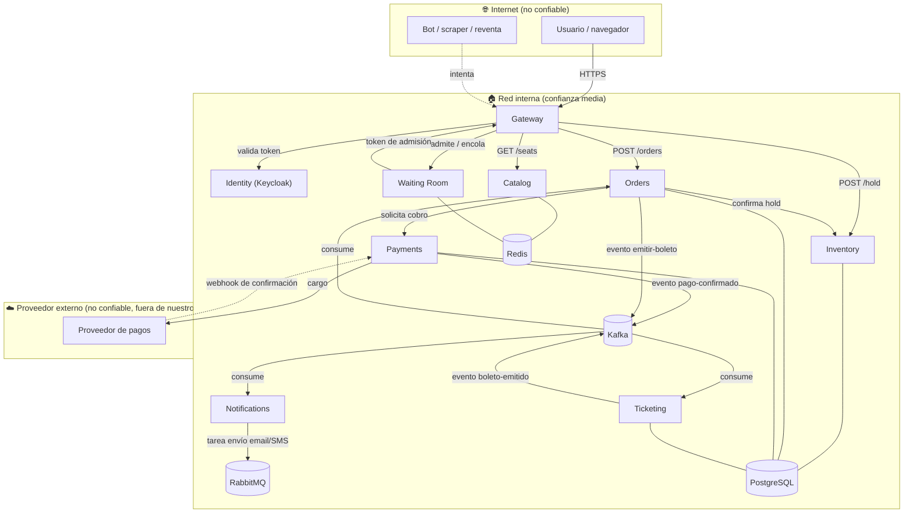

# Threat model inicial — TicketGT

Primera pasada de modelado de amenazas usando STRIDE. Cubre el sistema tal como está
descrito hoy (ver arquitectura en la descripción del proyecto). Se revisa de nuevo cada
vez que se agregue un servicio o un flujo externo nuevo (p. ej. al integrar el proveedor
de pagos real o exponer webhooks nuevos).

## 1. Diagrama de flujo de datos (DFD)

Cajas = procesos/servicios. Cilindros = almacenamiento. Las líneas punteadas marcan
**fronteras de confianza**: cruzar una de estas líneas es donde el riesgo cambia y donde
hay que validar en vez de confiar.

**Fronteras de confianza marcadas:**

1. **Internet ↔ Red interna** (todo lo que entra por `Usuario`/`Bot` hacia el Gateway es
   no confiable hasta que se autentica y valida).
2. **Red interna ↔ Proveedor de pagos** (control de cambios, disponibilidad y seguridad
   del proveedor están fuera de nuestro alcance; el webhook que entra desde ahí se trata
   como entrada no confiable aunque venga de un socio).
3. (Implícita, dentro de "Red interna") **Servicios ↔ almacenamiento**: solo el servicio
   dueño de cada base de datos debería tener credenciales de escritura sobre ella.

## 2. Activos a proteger

| Activo | Por qué importa |
| -- | -- |
| Estado de los asientos (`AVAILABLE`/`HELD`/`SOLD`) | Es el inventario real del negocio; si se corrompe, se vende dos veces o se pierde venta |
| Boletos emitidos | Representan el derecho de entrada; falsificarlos o duplicarlos es el fraude más directo |
| Datos personales (nombre, email, teléfono) | Obligación legal de protegerlos; fuga = incidente de privacidad |
| Datos de pago (tokens, no el número de tarjeta completo) | Aunque se tokeniza con el proveedor, el token en sí permite cobrar si se filtra |
| Claves de firma (JWT de sesión, firma de boletos/QR) | Si se filtran, cualquiera puede falsificar sesiones o boletos válidos |
| Credenciales de servicio a servicio (secrets de Kafka/RabbitMQ/Postgres) | Acceso directo a infraestructura si se filtran |
| Disponibilidad del sistema durante la venta | El negocio completo depende de que el sistema aguante el pico; downtime = pérdida de ingreso y reputación |

## 3. Perfiles de atacante

| Atacante | Motivación | Capacidad |
| -- | -- | -- |
| Bot de reventa | Comprar en volumen para revender más caro | Scripts automatizados, múltiples IPs/cuentas, sin límite de intentos |
| Estafador de tarjetas (carder) | Probar tarjetas robadas o pagar con tarjetas clonadas | Automatiza intentos de pago con tarjetas distintas contra el mismo monto |
| Cliente curioso/malicioso | Ver o modificar datos de otro usuario (boleto, orden) | Manipula IDs en la URL o el payload (IDOR), sin herramientas sofisticadas |
| Empleado malicioso / insider | Alterar asientos, emitir boletos sin pago, filtrar datos | Acceso legítimo a sistemas internos o a la base de datos |
| Dependencia comprometida (supply chain) | Ejecutar código arbitrario vía una librería o imagen base comprometida | Acceso al mismo nivel que el proceso que la usa |

## 4. STRIDE por flujo — amenazas priorizadas (top 15)

Prioridad = Impacto × Probabilidad (ambos en escala Alta/Media/Baja). Se ordena de mayor a
menor prioridad. `S T R I D E` marcan qué categorías de STRIDE aplican a esa amenaza
(**S**poofing, **T**ampering, **R**epudiation, **I**nformation disclosure, **D**enial of
service, **E**levation of privilege).

| # | Flujo | Amenaza | STRIDE | Impacto | Prob. | Mitigación prevista |
| -- | -- | -- | -- | -- | -- | -- |
| 1 | Webhook de pago → Payments | Webhook falso o con monto alterado | S, T | Alto | Media | Firma HMAC del proveedor + verificación de monto contra la orden original + idempotencia por `event_id` |
| 2 | Cliente → Inventory (hold) | Condición de carrera explotada a propósito para vender el mismo asiento dos veces | T | Alto | Media | Bloqueo optimista/transacción atómica en BD + reconciliador (ver R1 en `requirements.md`) |
| 3 | Orders → Payments | Reintento/replay de una solicitud de cobro ya procesada | R, D | Alto | Media | `Idempotency-Key` obligatoria en `POST /payments`, rechazo de duplicados a nivel de BD (constraint único) |
| 4 | Cliente → Orders/Ticketing | Enumeración de IDs para ver la orden o el boleto de otro usuario (IDOR) | I | Alto | Alta | Autorización por propietario del recurso en cada endpoint, IDs no secuenciales (UUID) |
| 5 | Bot → Gateway/Waiting Room | Bots acaparando lugares en la fila virtual o comprando en volumen | D, E | Alto | Alta | Challenge (captcha/proof-of-work), rate limit por IP/cuenta/dispositivo, detección de patrones de ráfaga |
| 6 | Estafador → Payments | Probar muchas tarjetas distintas contra el mismo monto (tarjeteo) | D | Alto | Media | Rate limit por cuenta/tarjeta, delegar detección de fraude al proveedor de pagos, bloqueo tras N intentos fallidos |
| 7 | Empleado malicioso → Base de datos | Alterar manualmente el estado de un asiento o emitir un boleto sin pago | T, R | Alto | Baja | Principio de mínimo privilegio en credenciales de BD, auditoría de cambios (`audit_log`), acceso de solo lectura fuera de horario |
| 8 | Dependencia comprometida → cualquier servicio | Librería o imagen base con código malicioso inyectado | T, E | Alto | Baja | Escaneo de dependencias (SCA) en CI, imágenes base fijadas por digest, revisión de actualizaciones |
| 9 | Cliente → Gateway | Robo de token de sesión (XSS, token en URL, dispositivo comprometido) | S | Alto | Media | TLS en todo el tráfico, tokens de vida corta, `httpOnly`/`Secure` en cookies, rotación de refresh tokens |
| 10 | Cliente → Gateway | Datos sensibles interceptados en tránsito | I | Alto | Baja | TLS 1.2+ obligatorio, HSTS, deshabilitar protocolos/cifrados débiles |
| 11 | Claves de firma → cualquier servicio que firme/valide | Filtración de la clave privada de firma de JWT o de boletos/QR | S, E | Alto | Baja | Rotación periódica, almacenamiento en un gestor de secretos (no en variables de entorno planas ni en el repo) |
| 12 | Kafka (evento pago-confirmado) → Orders/Ticketing | Publicación de un evento falso de "pago confirmado" sin que exista el pago real | S, T, E | Alto | Baja | ACLs de Kafka por servicio (solo Payments puede publicar en ese tópico), validación de esquema de evento |
| 13 | Cliente → Catalog | Scraping agresivo del catálogo que degrada el servicio para usuarios reales | D | Medio | Alta | Cache (Redis) con TTL corto, rate limit, CDN/edge cache para `GET /events` |
| 14 | RabbitMQ (DLQ de Notifications) → operador | Datos personales acumulados sin cifrar en la cola de mensajes muertos, accesible a quien administra la cola | I | Medio | Media | Cifrado en tránsito y reposo de RabbitMQ, acceso restringido a la consola de administración, purga programada de la DLQ |
| 15 | Endpoints de observabilidad (Prometheus/Grafana) → Internet | Exposición accidental de métricas/dashboards sin autenticación | I | Medio | Media | Autenticación obligatoria, exposición solo dentro de la red interna o vía VPN, nunca en el Gateway público |

**Quedan fuera del top 15** (documentadas pero de menor prioridad por ahora, se revisan en
la siguiente iteración): manipulación directa de la posición en la fila virtual vía Redis,
disputas de cargo (chargeback) como vector de repudio en Payments, y fuga de información
por mensajes de error demasiado detallados en las APIs públicas.

## 5. Próxima revisión

Este documento se revisa cuando: se agregue un servicio o flujo externo nuevo, se integre
el proveedor de pagos real (reemplazando el mock), o se detecte un incidente que no estaba
contemplado aquí. Cada revisión queda registrada como una entrada nueva en
[`docs/lab/`](../lab/) si cambia una mitigación, o como un ADR en [`docs/adr/`](../adr/) si
cambia una decisión de arquitectura.
